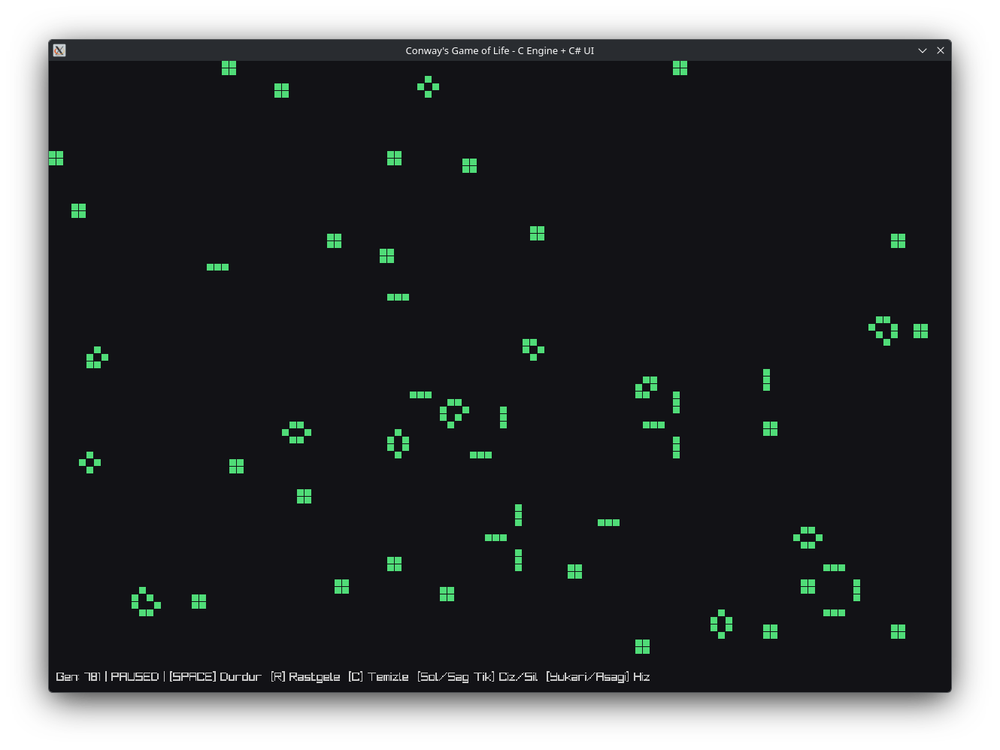

### Conway's Game of Life (C Engine + C# UI)

A high-performance, data-oriented implementation of Conway's Game of Life. The simulation core is written in pure C for cache-friendly execution and auto-vectorization, while the interactive desktop frontend is built in C# (Raylib-cs) reading the C native memory buffer directly via P/Invoke with zero copying.
Architecture & Optimizations

    Decoupled Core & Frontend (engine.c / GolUI): The simulation engine is compiled as a shared library (libgol.so), completely isolated from presentation logic. It can run either as a standalone ANSI terminal executable or as a native backend for graphical frontends.

    1D Flat Memory Layout: Both generation buffers are allocated as contiguous 1D byte arrays (index = row * stride + col) to maximize CPU L1/L2 cache locality and hardware prefetching.

    Ghost Border (Halo Padding): The grid is allocated with a 1-cell dead padding border ((rows + 2) * (cols + 2)). With outer boundaries guaranteed to be 0, the inner neighbor loop runs completely branch-free, enabling SIMD auto-vectorization.

    O(1) Pointer Swap: State transitions between generations swap the current and next pointers in constant time without memcpy overhead.

    Zero-Copy C# P/Invoke Bridge: The C# frontend allocates native aligned memory (NativeMemory.AllocZeroed), passes raw pointers to libgol.so, and renders directly from the unmanaged buffer without Garbage Collector pressure.

### Build & Run

### Option 1: C# Graphical UI (Raylib-cs)

Compile the C engine as a shared library and copy it to the UI directory:

    gcc -O3 -march=native -fPIC -shared engine.c -o GolUI/libgol.so

Run the C# frontend:
    cd GolUI
    dotnet run -c Release

Controls:

    Left / Right Click: Draw or erase live cells

    Space: Pause / Resume simulation

    R: Randomize grid

    C: Clear grid

    Up / Down Arrows: Increase or decrease simulation speed

### Option 2: Standalone ANSI Terminal Version
    gcc -O3 -march=native terminal.c engine.c -o app
    ./app

### License

This project is licensed under the GNU General Public License v3.0 - see the LICENSE file for details.